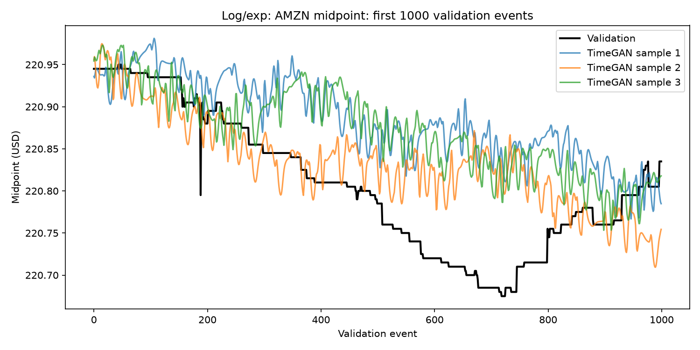
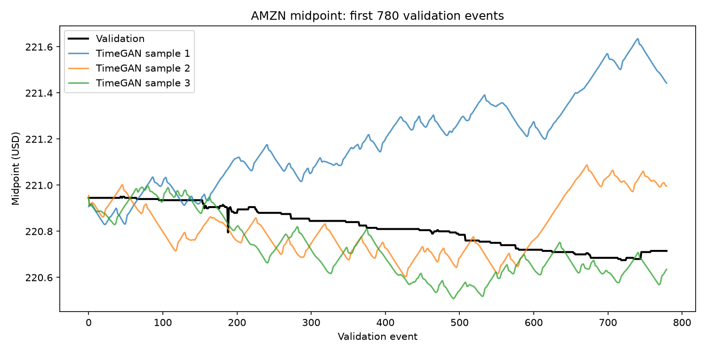
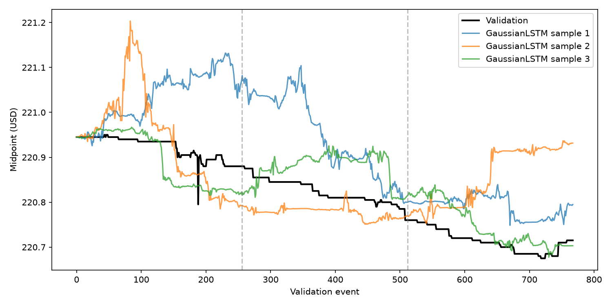

# Limit Order Book Generation using TimeGAN

## Algorithm and problem description

Our goal is to generate realistic sequences of limit order book data, particularly for the trading of an equity stock.

The data is structured as a time-series of order books: 10 asks, 10 bids and a volume of orders for each ask/bid price point.

## How it works

TimeGAN is a combination of the Recurrent Neural Network (RNN) and Generative Adversarial Network (GAN) architectures.
It includes a recurrent auto-encoder alongside a recurrent GAN, which are trained alongside each other optimising three loss functions:

1. an adversarial loss (used for the discriminator and generator, optimised adversarially),
2. a reconstruction loss, used for the auto-encoder part of the network, and
3. a supervised loss (explained in further detail below).

What allows these two otherwise-separate networks to interact with each other's training and loss is the employment of a latent, or embedding, space.
The encoder RNN calculates latent vectors, supposed to represent the feature vector(s) to be encoded.
The generator RNN generates vectors in this latent space (rather than in the feature space).
The discriminator network is then trained to discriminate between the latent representations of these two processes.
Moreover, there is also a supervisor RNN trained to predict the next latent vector.

The original TimeGAN paper (accessible using [this hyperlink](https://papers.nips.cc/paper/2019/file/c9efe5f26cd17ba6216bbe2a7d26d490-Paper.pdf))
details the separation of time-series data into static and temporal features.
However, we discard any notion of "static" feature training as our whole dataset comprises of one dataset which is a single time series.
Therefore, our relevant "static" features are already fixed, so there is no need to include them in this analysis.

## Figure/visualisation

Some long-running predictions from the TimeGAN at the beginning of the validation set.

## Feasibility review

We investigate the plausibility and efficacy of using deep learning models,
particularly TimeGAN, as a method of generating plausible time series of equity
limit order books for offline statistical and structural analysis. Therefore,
the users of this system are developers of statistical models needing large
amounts of plausible historical data. A non-objective of this analysis is to
provide a testing environment for trading algorithms, particularly those whose
strategy focuses on real-time arbitrage. Real-time trading is a responsive and
adversarial system, which our statistical time-series models cannot effectively
capture, so we rule out this use case.

We want to ensure that our order books follows the accepted model for equity
prices, particularly geometric Brownian motion, i.e. satisfying the stochastic
differential equation: dS=S dt+S dW, where W is a random variable generated by
a Wiener process (Black & Scholes, 1973, p. 1 eq. 3). We quantify this using KL
divergence. We also want to ensure that the order books our model predicts,
fulfills all of our prior expectations, namely that all predicted bids and asks
are non-negative, that both bids and asks are monotonically decreasing and
increasing, and that the best bid is less than the best ask.

We split our data temporally into a training and validation set (the training
set being the first 85% of points in the dataset, and the validation set being
the final 15%). This ensures continuity of our prediction, while also
eliminating any lookahead bias. As most events in the dataset don’t move the
price, we also summarise points in short time windows to those which do,
reducing training data size by about 70% while not impacting model performance.

We model our feature space such that the model is constrained to predict
according to our aforementioned prior assumptions about the data. For instance,
instead of representing asks and bids as different prices, we only model the
positive difference, or “spread,” between them. We do this by having the
feature represent the log of the spread, and thus the spread can only be
positive. Similar constraints are enforced for the rest of the feature space,
so we have certainty about the enforcing of our prior assumptions.

One of the primary risks in employing TimeGAN in this approach is the
complexity in both training procedure and optimisation, as well as ease of
understanding for stakeholders and researchers. A workable fallback that
addresses this is to use a stacked LSTM model which predicts an axis-aligned
gaussian distribution of the next feature vector. This can be both used as a
point-predictive model (by just choosing the mean), or as a generative model
(by repeatedly sampling the distribution).

Given the relative low-dimensionality of the data, we expect that the model
should be small and able to run on most modern commercially-available GPUs, so
we constrain the training VRAM usage to 4GB, though in practice, we could use
less or more, depending on desired complexity.

#### Feasibility Review References

Black, F., & Scholes, M. (1973). The pricing of options and
corporate liabilities. Journal of Political Economy, (81(3)), 637-654.
[https://doi.org/10.1086/260062](https://doi.org/10.1086/260062)

## Running Scripts in this Directory

1. Install the UV package manager (by Astral Software Inc.). Instructions can
   be viewed using [this hyperlink](https://docs.astral.sh/uv/getting-started/installation/).
2. In this (`recognition/`) directory, run `uv sync`.
3. Scripts in this directory can be run using the command `uv run`, followed by
   the name of the script. E.g. `uv run train.py` will run `train.py`.

## Pre-processing and data splits

In order to enforce validity of all generated order books, a feature space which is constrained to encode order books that meet our prior invariants.

Firstly, we encode the midpoint price indirectly by representing it as its natural logarithm.
This both ensures that when we perform our deterministic mapping from the feature space to interprable values, this price will always be positive.
It also helps that, as cited in the feasibility review, this aligns with the financial literature's model of equity prices.

Similarly, we encode the ask-bid spread as a positive value (ensured using the natural logarithm, as above); and the 'deeper' asks and bids are encoded as the gaps between sequential asks or bids.
For instance, we do not store the third-best ask directly, rather we store the positive difference between the second-best and third-best ask, and the difference between the best and second-best ask,
so the third-best ask is calculable from the other features.
As all these gaps are positive, we are constrained to only predict valid order books.

In combination with the techniques above, feature representations are standardised to help make full use of floating point precision,
and to avoid feature imbalances when scoring models using mean squared error.

One limitation of this approach, is that if the midpoint price approaches zero, the bids for the price are able to become negative.
In practice, no issues of this sort were encountered, as the training and validation data are kept far out of this range,
though if this model were to be extended to be used on other stocks, the risks and mitigations would need to be reassessed.

The training and validation split was chosen to be 85% and 15% respectively.
The two are separated such that the training set is chronologically first, and the validation set last.
Notably absent here is a test split of the data.
This was omitted as the model's generative nature makes it difficult to be optimised by the researcher to match the validation set in particular.
I.e., multiple varied completions of the training set can be generated, none of which are expected to "converge" on the validation set.

## Investigation of the Open Research Dilemma

### Quantitative benchmarking

Despite introducing a KL loss term to TimeGAN, target KL loss of 0.1 was not able to be achieved.

* TimeGAN KL loss of log returns: 1.55.
* Baseline LSTM KL loss of log returns: 0.69.

Due to a strong mode of zero in the dataset, getting KL divergence to be reduced posed challenges.
For instance, the baseline model predicted a distribution of the next data point which was gaussian.
However, with long runs of zeros, even a tight gaussian distribution would inevitably have some variability in it.

### Resource profiling

TimeGAN resources:

* Training VRAM: < 4GiB. Measured using `nvidia-smi` while the program was
  running. Due to programming environment (WSL), exact information about
  per-process VRAM usage was unavailable, but overall usage remained constant
  throughout training.
* Total model parameters: 1,859,113.
* Training time (on Nvidia RTX 5070 GPU): ~950s.

Compared to baseline, stacked LSTM resources:

* Training VRAM: < 1.5GiB.
* Parameters: 229,456.
* Training time: ~90s.

### Engineering Recommendation and Trade-Offs

While both the baseline stacked LSTM and TimeGAN models show great potential,
the simpler LSTM model was more adaptable, more stable to train, simpler to
program and less compute intensive, so the engineer authoring this review would recommend it over TimeGAN.
A particular struggle using TimeGAN was the introduction of a latent space.
This complicated training, made various results less interprable, and in turn allowed the researcher less flexibility in enforcing domain constraints.
A qualitative example of this can be seen with predictions from each model at a small scale (example plots below).
As previously mentioned a feature of the dataset is a strong mode of zero (due to midpoint prices remaining stagnant for brief moments in time, while best-ask and best-bid prices contain large volumes).
The LSTM model, having the ability to directly output values in the feature space, can produce these trends.

TimeGAN close-up predictions:

LSTM close-up predictions:

Technically, for the patterns of the training data to "imprint" themselves on
the generator, they must first be learned by the encoder, then, by
backpropagation, be learned by the discriminator, and by a second pass of
backpropagation, be finally learned by the generator, which produces replicated results.
This is one step more abstracted from the data than even a traditional GAN, as
patterns pass through two other models in a feature space foreign to that of
the processed data.

Concerning order structure, the models (they each use the same feature space)
do not produce any crossed order books, non-monotonic prices or otherwise
invalid books due to the domain-constrained encoding in the feature space.
So stakeholders concerned about this kind of invalidity can know that it is not possible once features are decoded.

## Artificial Intelligence Usage Disclosure

Generative artifical intelligence was used in the making of this assignment.
The models used included OpenAI's GPT-5.3 Luna, GPT-6 Luna, GPT-6.1 Sol,
GPT-5.3 Sol using the agentic Opencode and Codex coding tools.

The use of these tools included code generation, debugging and research.

All final code has been reviewed and/or re-written by hand, and contents of
this README, including the feasibility review, were also written without these
tools (aside from using an LLM to create a template of the README, comprising
of section titles and HTML/Markdown comments within the file).
